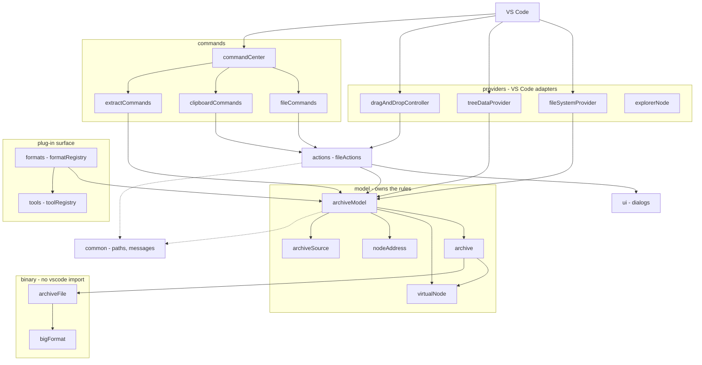
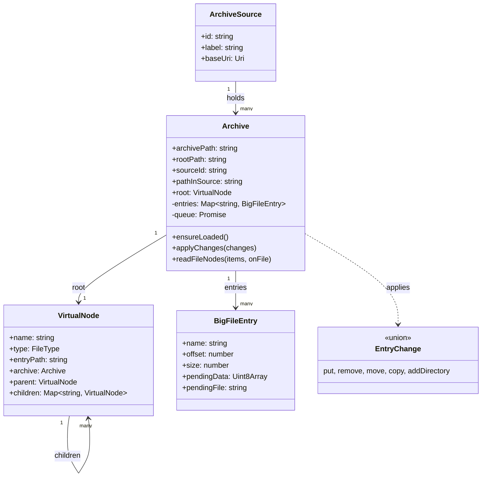
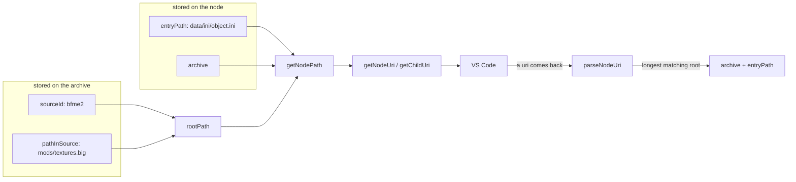
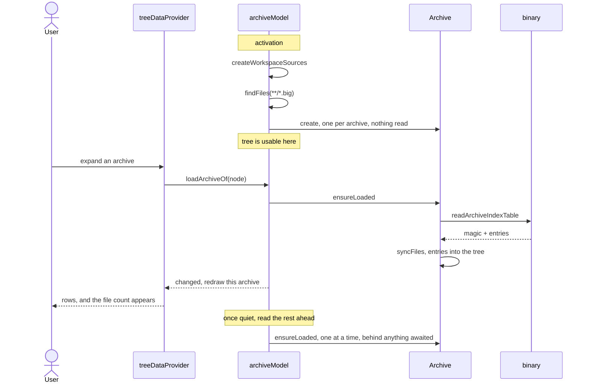
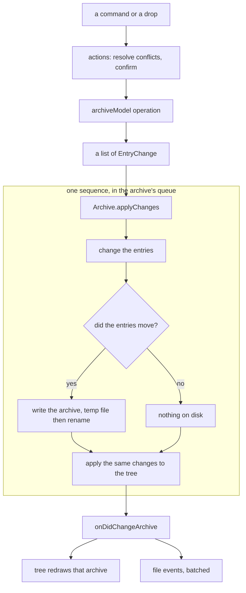
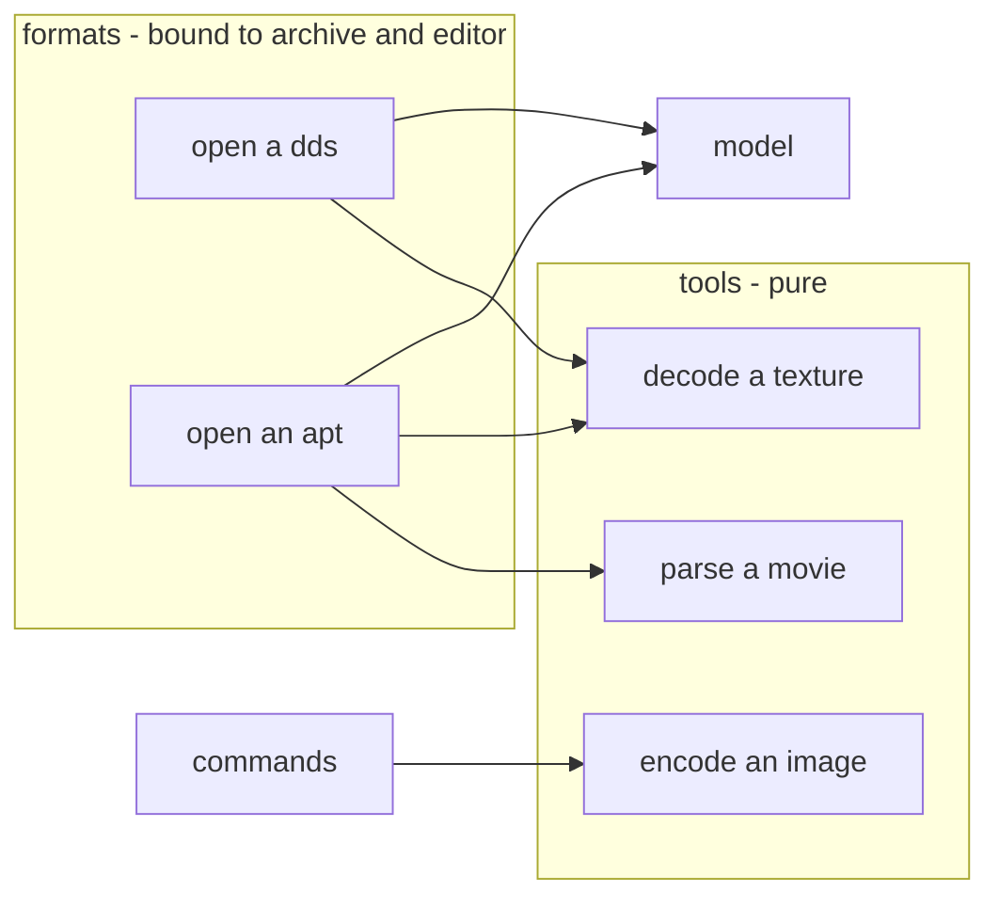

# bigFS architecture

How the extension is put together: the layers, the data, how a read and a
write flow through them, and where new file formats and tools plug in.

This describes the code as it stands. Open questions are at the end.

---

## 1. What a BIG archive actually is

Three properties of the format decide most of the design, so they come first.

**An archive stores file paths and nothing else.** There are no directory
records. A directory exists because some file's path contains it, which is why
a directory the user creates lives only in the tree and writes no bytes.

**The index table is derived, never edited.** It is a header, then one record
per entry giving an offset, a size and a name. You do not update it
independently: it is written from the entry set.

**There is no partial write.** Changing one entry shifts every offset after it,
so any change rewrites the whole file, through a temporary file that is renamed
over the original.

Entry names are stored with backslashes and matched case insensitively, which
is why the tree and the entry map are keyed case insensitively while keeping
the casing an entry was stored with.

---

## 2. The layers

The rule the arrows follow: **`binary` knows nothing about VS Code, `model`
knows nothing about commands or views, `common` knows nothing about this
extension at all.** Everything above the model works with nodes.

| directory | holds |
| --- | --- |
| `binary/` | the BIG file format: parse, serialize, read, write |
| `model/` | archives, the virtual tree, addressing, sources |
| `providers/` | the three VS Code adapters |
| `commands/` | what the palette and context menu invoke |
| `actions/` | operations shared by commands and drag and drop |
| `ui/` | prompts and confirmations |
| `tools/`, `formats/` | the plug-in surface |
| `common/` | generic helpers, no domain knowledge |

---

## 3. The data

**The entries own the content, the tree owns the structure.** A file appears in
both; a directory only in the tree. That is what lets a directory survive
losing its last file without anything tracking it separately, and it is why
the tree is mutated alongside the entries rather than rebuilt from them.

`pendingData` and `pendingFile` are how content that is not in the archive yet
travels to the writer: bytes held in memory, or a file on disk copied straight
across while the archive is written so it never passes through memory.

---

## 4. Addressing

The same entry has three names, and only one of them is stored.

| name | example | who uses it |
| --- | --- | --- |
| **entry path** *(stored)* | `data/ini/object.ini` | the index table, the entry map, the tree |
| node path *(rendered)* | `/bfme2/mods/textures.big/data/ini/object.ini` | tree row ids, tooltips, error messages |
| uri *(rendered)* | `bigfs:/bfme2/mods/textures.big/data/ini/object.ini` | VS Code only |

A node stores its `entryPath` and a reference to its `Archive`. Everything else
is derived, by `model/nodeAddress`:

Two consequences worth knowing:

- **A uri names its source first.** Two archives called `INI.big` in different
  folders have different paths, so neither can claim the other's entries.
- **Nothing outside `nodeAddress` takes an address apart.** `parseNodeUri` is
  the only parser, and it is reached only through the file system provider,
  which is the only place a uri arrives from outside.

---

## 5. Reading

Nothing is opened at startup. The scan lists what carries the extension, and an
archive is read when something needs it.

A file that carries the extension but is not an archive is dropped when reading
it says so, rather than by opening every candidate during the scan.

Reading content is a positional read: `openArchiveReader` keeps one handle open
so extracting a folder does not reopen the archive per entry.

---

## 6. Writing

Every mutation is described as changes and carried out by one runner. An
operation says *what changes*; nothing else.

The queue is per archive and shared with reads, so a reload triggered by the
watcher cannot land in the middle of a save.

| operation | changes | touches disk |
| --- | --- | --- |
| write a file | `put` | yes |
| create a directory | `addDirectory` | **no** |
| delete | `remove` | yes, unless nothing was stored |
| rename or move | `move` | yes |
| copy or duplicate | `copy` | yes |
| add files from disk | `put` per file, streamed | yes |

---

## 7. The plug-in surface

Two kinds of contribution, told apart by what they are allowed to know.

| | tool | format |
| --- | --- | --- |
| answers | transform this data | open this entry |
| knows about archives | no | yes |
| knows about VS Code | no | yes |
| testable without a host | yes | no |

A tool is a pure function with an id. A format is handed a context that can
find a sibling by extension, list a directory, and read entries in a batch. It
gets a **reader**, not pre-resolved buffers, because a format cannot always
declare what it needs in advance: an `.apt` finds its `.const` and `.dat` by
name, then asks for textures it only discovers while parsing.

Both registries exist and are empty. Registering either is one line in
`extension.ts`.

**Not yet decided:** a format that needs its own viewer also needs a
`contributes.customEditors` entry in `package.json`, whose file pattern is
static. Either each format adds a manifest entry, or one editor registers at
`priority: "option"` so it is reachable through *Reopen With* without
hijacking anything.

---

## 8. Measurements

Taken against a real Battle for Middle-earth 2 install, 105 archives and
3.4 GB on disk.

| | |
| --- | --- |
| reading every index table | 174 ms total, 1.7 ms per archive |
| heap held for all 105 | 9.2 MB, 0.09 MB per archive |
| tree nodes across all of them | 41,049 |
| largest archive | `W3D.big`, 12,893 nodes |
| opening one file | 0.3 ms, independent of archive size |
| expanding a folder of 30,000 rows | 20 ms |

The lesson worth keeping: **archive size on disk says nothing about index
size.** 3.4 GB of BFME is textures and audio, not many files. Estimates made
from synthetic archives with tens of thousands of entries each were wrong by
more than an order of magnitude.

---

## 9. Decisions worth remembering

- **Node's `fs`, not `workspace.fs`, in `binary/`** — reading one entry out of
  a 2 GB archive needs a positional read, and `workspace.fs` can only read a
  whole file. The cost is that only local files work: a remote workspace has no
  path to open.
- **The tree is mutated, not rebuilt.** Rebuilding it from entries would lose
  every directory that holds no files, which is what a side table used to
  compensate for.
- **A node keeps its identity.** The tree view holds the elements it was
  handed, so refreshing one archive means firing the very root it already
  knows.
- **Errors are exceptions at the VS Code boundary**, because the provider API
  requires thrown `FileSystemError`s. Tagged errors such as `NotAnArchiveError`
  cover the cases callers branch on.
- **Mutation is confined by structure, not by interception.** Tree mutation
  happens only in `virtualNode`, entry mutation only in `archive`.

---

## 10. Still open

**Core**

- A plan targets one archive, so **cross archive move and copy** need the plan
  widened into a transaction over several. Ordering belongs in the runner:
  write the target before removing the source, so a failure leaves a duplicate
  rather than a hole.
- **The merged game view**: one index per source, entries resolved by load
  order, with the hover showing which archive wins. Needed before INI cross
  referencing, since a reference from a mod into the base game has to resolve.
- **Archives added by hand** from outside the workspace. The source layer takes
  this without changing: it is a source implementation, a command, and
  persistence.

**Plug-ins**

- `.dds` decoder and viewer, `.apt` parser and writer. The `.apt` tools depend
  on nothing here and can be written against fixtures whenever.
- Language support for `.ini` and `.inc`, which needs the merged view and a
  cache of parsed results keyed by archive version.

**Known gaps**

- Saving a large archive has no progress and cannot be cancelled.
- Every save rewrites the whole archive. Writing into free space and rewriting
  only the index would avoid it, at the cost of a compaction step.
- Drag and drop and the clipboard commands have no automated cover; neither is
  reachable through the extension host API the suite uses.
- Release: README and CHANGELOG are still scaffold text, there is no LICENSE or
  `license` field, no icon, and the publisher name is a guess.
