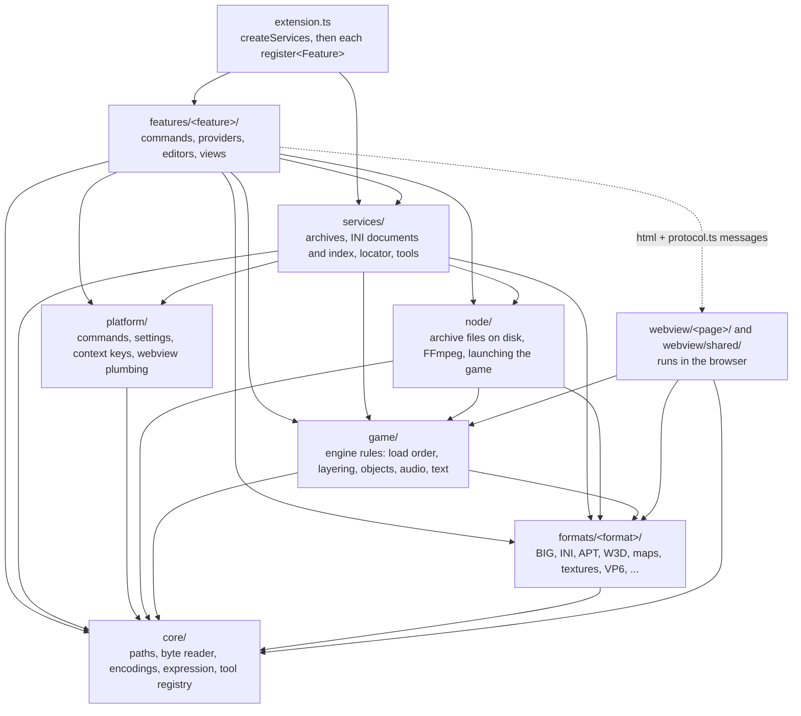
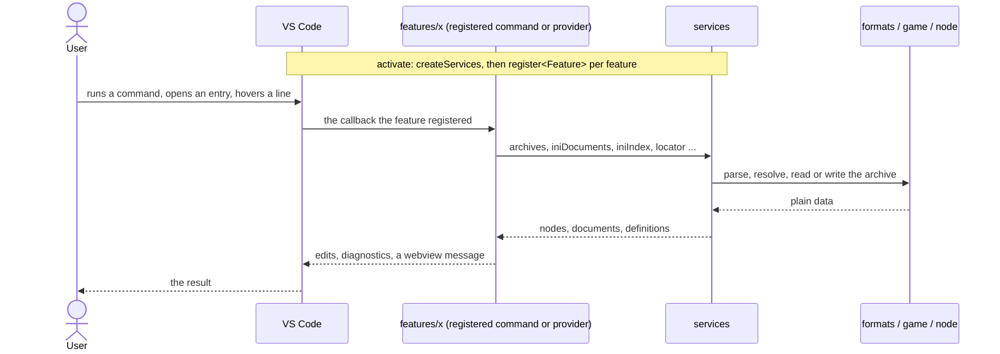
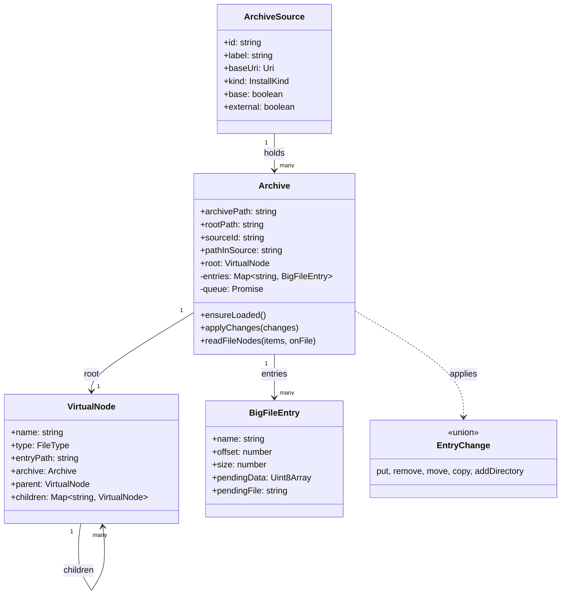
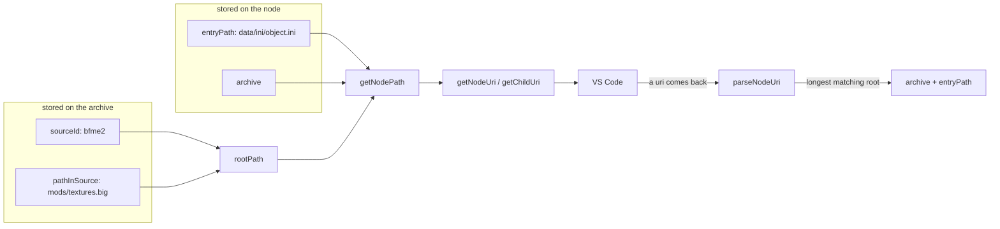
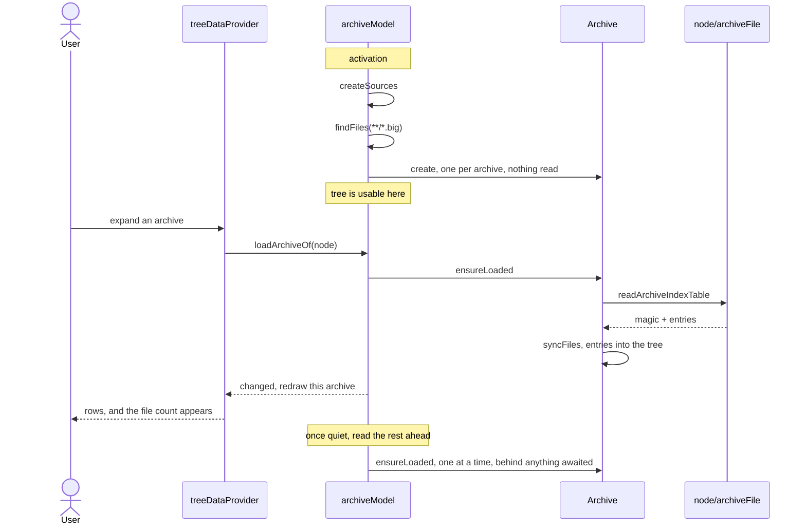
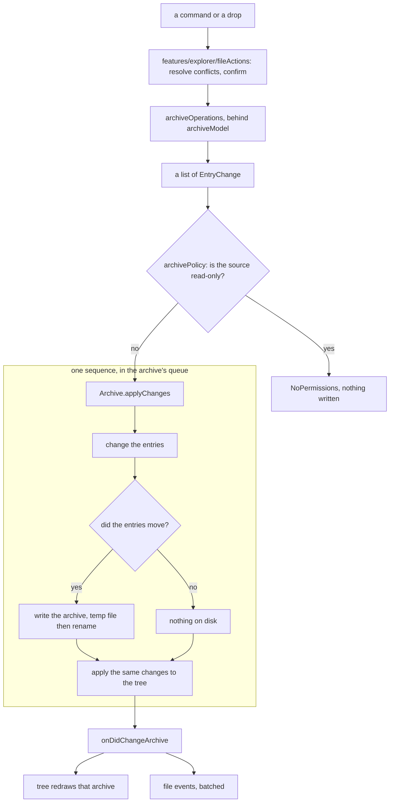
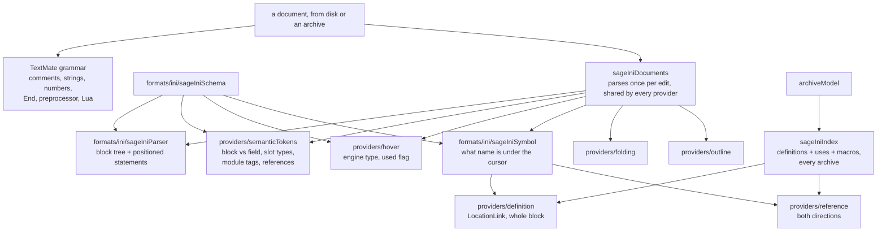

# bigFS architecture

How the extension is put together: the layers, the data, how a read and a
write flow through them, and where new file formats and tools plug in.

This describes the code as it stands. Open questions are at the end.

---

## 1. What a BIG archive actually is

Three properties of the format decide most of the design, so they come first.

**An archive stores file paths and nothing else.** There are no directory
records. A directory exists because some file's path contains it, which is why
a directory the user creates lives only in the tree and writes no bytes.

**The index table is derived, never edited.** It is a header, then one record
per entry giving an offset, a size and a name. You do not update it
independently: it is written from the entry set.

**There is no partial write.** Changing one entry shifts every offset after it,
so any change rewrites the whole file, through a temporary file that is renamed
over the original.

Entry names are stored with backslashes and matched case insensitively, which
is why the tree and the entry map are keyed case insensitively while keeping
the casing an entry was stored with.

---

## 2. The layers

The code is layered from generic helpers at the bottom to user-facing
features at the top. `conventions.md` holds the import matrix and says where
new code goes; `eslint.config.mjs` enforces it, and a layer import that breaks
it fails `npm run lint`.



| folder | holds | may import |
| --- | --- | --- |
| `core/` | generic, browser-safe helpers: paths, `byteReader`, Windows-1252, expressions, debounce, messages, the tool registry, transfer planning | itself |
| `formats/<format>/` | one file format each, parse, write and edit, no host: `big`, `ini` (the SAGE INI dialect: lexer, parser, schema, references, problems), `apt`, `w3d`, `map`, `texture`, `audio`, `vp6`, `wnd`, `str`, `csf`, `cah`, `refpack`, `particles`, `mappedImage` | core |
| `game/` | how the engine behaves: the game view and install layering (`install/`), object composition and stats (`objects/`), audio resolution (`audio/`), language and translations (`text/`), the policies behind the INI checks (`ini-tools/`) | core, formats |
| `node/` | Node I/O: reading and writing archive files, install discovery, mod diff and packaging on disk, FFmpeg, PNG encoding, the launch plan | core, formats, game |
| `platform/` | VS Code adapters with no domain knowledge: `registerCommand`, typed settings, context keys, dialogs, webview pages, singleton panels, snapshot editors | core |
| `services/` | the long-lived state built once in `createServices.ts`: `archives/` (`ArchiveModel` and its scanner, registry, policy and operations, the virtual tree, addressing, the game view model, the explorer selection and node command registrar), `ini/` (`SageIniDocuments`, `SageIniIndex`, game language, audio lookup, asset check, effective objects), `entryLocator`, `mappedImagePreview`, `effectLibrary` | everything below, `vscode` |
| `features/<feature>/` | one user-facing feature each, wired by its `index.ts` | everything below, its own `webview/<feature>/protocol` |
| `webview/<page>/` | the code inside one webview page, bundled by `esbuild.mjs` into `dist/webview/<name>.js` | core, formats, game, `webview/shared/` |

The pure layers (`core`, `formats`, `game`) import neither `vscode` nor Node,
which is what lets the unit tests in `src/test/unit` reach them without
starting VS Code and lets the pages bundle them for the browser. A feature
never imports another feature: what two features share lives in a service or
lower.

### How a request flows

`extension.ts` is the composition root. `activate` calls `createServices`,
which builds the services and starts the archive scan and the INI index
without awaiting them, then calls each feature's `register<Feature>` from the
ordered `FEATURES` list. The order matters only where VS Code consults
providers in registration order (lenses and code actions on INI lines).



A webview editor adds one hop: the feature renders the page with
`platform/webview/webviewPage`, the page code in `webview/<page>/main.ts`
draws, and the two exchange the messages typed in
`webview/<page>/protocol.ts`. A page never touches a file; it sends an edit and
is sent the result.

### Where to start debugging

Every feature starts at `src/features/<feature>/index.ts`, which names the
modules it registers. From there:

| symptom in | start at | then |
| --- | --- | --- |
| archive explorer, the `bigfs:` file system, drag and drop, extract, copy paths | `features/explorer/` | `services/archives/archiveModel.ts` and its `archiveScanner`, `archiveRegistry`, `archivePolicy`, `archiveOperations`; `node/archiveFile.ts`; `formats/big/bigFormat.ts` |
| the game view (which file wins) | `features/explorer/treeDataProvider.ts` | `services/archives/gameViewModel.ts`, `game/install/gameView.ts` |
| row commands acting on the wrong rows | `services/archives/nodeCommands.ts` | `services/archives/explorerSelection.ts` |
| INI highlighting, hover, completion, navigation, rename, diagnostics | `features/iniLanguage/providers/` | `services/ini/sageIniDocuments.ts`, `sageIniIndex.ts`; `formats/ini/` |
| INI checks (assets, unused, duplicates, validation, hotkeys) | `features/iniLanguage/` | `services/ini/sageIniAssetCheck.ts`, `diagnoseIniText.ts`; `game/ini-tools/` |
| effective object view, new object wizard | `features/objects/` | `services/ini/effectiveObject.ts`, `game/objects/` |
| particle and object previews | `features/particles/` | `webview/particles/`, `services/effectLibrary.ts`, `formats/particles/` |
| texture, audio and W3D previews | `features/preview/` | `webview/preview/`, the tools in `formats/texture`, `formats/audio`, `formats/w3d` |
| APT movies | `features/apt/` | `webview/apt/` (player and AVM in `avm/`), `formats/apt/`; `docs/apt-scripts.md`, `docs/apt-text-format.md` |
| maps and map scripts | `features/map/`, `features/scripts/` | `webview/map/`, `webview/scripts/`, `formats/map/` |
| string tables, translations | `features/strings/`, `features/translations/` | `webview/strings/`, `formats/str/`, `formats/csf/`, `game/text/` |
| Create-a-Hero | `features/cah/` | `webview/cah/`, `formats/cah/`, `game/objects/cahSystem.ts` |
| WND layouts | `features/wnd/` | `webview/wnd/`, `formats/wnd/` |
| CommandSet editor and hover | `features/commandSet/` | `services/ini/commandSetPreview.ts`, `webview/commandset/` |
| balance sheet, armor table, bulk edit | `features/balanceSheet/`, `features/armorTable/`, `features/bulkEdit/` | `game/objects/`, `game/ini-tools/bulkEdit.ts` |
| sound playback | `features/audio/` | `services/ini/audioLookup.ts`, `game/audio/sageAudioResolve.ts`, `webview/audio/` |
| videos | `features/video/` | `formats/vp6/`, `node/ffmpeg.ts`, `webview/video/` |
| textures and W3D animation commands | `features/textures/`, `features/w3d/` | `formats/texture/`, `formats/w3d/` |
| installs and launching | `features/installs/` | `node/installDiscovery.ts`, `node/launchPlan.ts`, `game/install/installLayers.ts` |
| mod diff, packaging, override in folder | `features/mods/` | `node/modDiff.ts`, `node/modPackage.ts` |

Errors from a command are written to the `bigFS` output channel by
`platform/commands.ts`, which is the first place to look when a command
appears to do nothing.

---

## 3. The data



**The entries own the content, the tree owns the structure.** A file appears in
both; a directory only in the tree. That is what lets a directory survive
losing its last file without anything tracking it separately, and it is why
the tree is mutated alongside the entries rather than rebuilt from them.

`pendingData` and `pendingFile` are how content that is not in the archive yet
travels to the writer: bytes held in memory, or a file on disk copied straight
across while the archive is written so it never passes through memory.

---

## 4. Addressing

The same entry has three names, and only one of them is stored.

| name | example | who uses it |
| --- | --- | --- |
| **entry path** *(stored)* | `data/ini/object.ini` | the index table, the entry map, the tree |
| node path *(rendered)* | `/bfme2/mods/textures.big/data/ini/object.ini` | tree row ids, tooltips, error messages |
| uri *(rendered)* | `bigfs:/bfme2/mods/textures.big/data/ini/object.ini` | VS Code only |

A node stores its `entryPath` and a reference to its `Archive`. Everything else
is derived, by `services/archives/nodeAddress`:



Two consequences worth knowing:

- **A uri names its source first.** Two archives called `INI.big` in different
  folders have different paths, so neither can claim the other's entries.
- **Nothing outside `nodeAddress` takes an address apart.** `parseNodeUri` is
  the only parser, and it is reached only through the file system provider,
  which is the only place a uri arrives from outside.

---

## 5. Reading

Nothing is opened at startup. The scan lists what carries the extension, and an
archive is read when something needs it.



A file that carries the extension but is not an archive is dropped when reading
it says so, rather than by opening every candidate during the scan.

Reading content is a positional read: `openArchiveReader` keeps one handle open
so extracting a folder does not reopen the archive per entry.

---

## 6. Writing

Every mutation is described as changes and carried out by one runner. An
operation says *what changes*; nothing else.



The queue is per archive and shared with reads, so a reload triggered by the
watcher cannot land in the middle of a save.

`ArchiveModel` is a façade over four modules in `services/archives/`:
`archiveScanner` finds and watches the archives, `archiveRegistry` looks them
up, resolves uris and reads them in the background, `archivePolicy` holds the
one decision on whether a source is read-only, and `archiveOperations` holds
the mutations and transfers. Every write path asks `archivePolicy`: the file
system provider before it calls the model, and each operation in its single
apply, so a base game source outside the workspace is never written to.

| operation | changes | touches disk |
| --- | --- | --- |
| write a file | `put` | yes |
| create a directory | `addDirectory` | **no** |
| delete | `remove` | yes, unless nothing was stored |
| rename or move | `move` | yes |
| copy or duplicate | `copy` | yes |
| add files from disk | `put` per file, streamed | yes |

---

## 7. Tools, formats and the game view

A format module in `formats/<format>/` is imported by whatever needs it; there
is no registry between them. A tool is a pure decoder with an id (TGA, DDS,
playable audio, W3D), declared beside its format (`formats/texture/textureTools.ts`,
`formats/audio/audioTools.ts`, `formats/w3d/w3dTools.ts`), registered once in
`services/createServices.ts` through `core/toolRegistry` and reached through
the `ToolBox` the previews are handed.

Anything that needs "the file the game would load" asks the game view, not the
archive it happens to hold. `game/install/gameView` is the engine's rule (loose
files first, archives in path order with the first holding a path winning,
installs layered mod over ROTWK over BFME II), `services/archives/gameViewModel`
keeps it current as archives change, and `services/entryLocator` is the lookup
viewers use for a skeleton or texture named by file name only.

Editors and previews that draw in a webview follow one shape: the extension
side owns the data and the file, the page code in `webview/` draws and sends
messages, and each page is one entry in `PAGES` in `esbuild.mjs`.

A format that needs its own viewer also needs a `contributes.customEditors`
entry in `package.json`, whose file pattern is static. The existing editors
(`bigfs.preview`, `bigfs.aptEditor`, `bigfs.strTable`, `bigfs.csfEditor`,
`bigfs.cahEditor`, `bigfs.mapEditor`) each have one.

---

## 8. Measurements

Taken against a real Battle for Middle-earth 2 install, 105 archives and
3.4 GB on disk.

| | |
| --- | --- |
| reading every index table | 174 ms total, 1.7 ms per archive |
| heap held for all 105 | 9.2 MB, 0.09 MB per archive |
| tree nodes across all of them | 41,049 |
| largest archive | `W3D.big`, 12,893 nodes |
| opening one file | 0.3 ms, independent of archive size |
| expanding a folder of 30,000 rows | 20 ms |

The lesson worth keeping: **archive size on disk says nothing about index
size.** 3.4 GB of BFME is textures and audio, not many files. Estimates made
from synthetic archives with tens of thousands of entries each were wrong by
more than an order of magnitude.

---

## 9. Decisions worth remembering

- **Node's `fs`, not `workspace.fs`, in `node/archiveFile`** — reading one entry out of
  a 2 GB archive needs a positional read, and `workspace.fs` can only read a
  whole file. The cost is that only local files work: a remote workspace has no
  path to open.
- **The tree is mutated, not rebuilt.** Rebuilding it from entries would lose
  every directory that holds no files, which is what a side table used to
  compensate for.
- **A node keeps its identity.** The tree view holds the elements it was
  handed, so refreshing one archive means firing the very root it already
  knows.
- **Errors are exceptions at the VS Code boundary**, because the provider API
  requires thrown `FileSystemError`s. Tagged errors such as `NotAnArchiveError`
  cover the cases callers branch on.
- **Mutation is confined by structure, not by interception.** Tree mutation
  happens only in `services/archives/virtualNode`, entry mutation only in
  `services/archives/archive`.

---

## 10. Still open

**Core**

- A plan targets one archive, so **cross archive move and copy** need the plan
  widened into a transaction over several. Ordering belongs in the runner:
  write the target before removing the source, so a failure leaves a duplicate
  rather than a hole.
- **Archives added by hand** are partly there: `external` sources are read from
  the folder rather than found by the workspace search, which is how the base
  game folders the settings name, and installs found by `installDiscovery`,
  enter the tree. What is open is a command to add an arbitrary folder and
  persistence for it.

**Features**

- The INI language service covers folding, outline, highlighting, completion,
  go to definition, references, rename and diagnostics (`features/iniLanguage/`,
  indexed across archives by `services/ini/sageIniIndex`). What is open is mostly depth: more
  field types checked, and a cache of parsed results keyed by archive version
  so a large workspace re-checks only what changed.

**Known gaps**

- Saving a large archive has no progress and cannot be cancelled.
- Every save rewrites the whole archive. Writing into free space and rewriting
  only the index would avoid it, at the cost of a compaction step.
- Drag and drop and the clipboard commands have no automated cover; neither is
  reachable through the extension host API the suite uses.
- Release: README and CHANGELOG are still scaffold text, there is no LICENSE or
  `license` field, no icon, and the publisher name is a guess.

---

## 11. The SAGE INI language layer

`.ini` and `.inc` entries are not INI files. They have no `[sections]`, the `=`
is optional, and a bare `End` closes a block. The hard part is that **nothing
in a line's syntax says whether it opens a block or is a leaf field**, and the
same keyword changes meaning with context:

```ini
Body   = ActiveBody ModuleTag_02     ; opens a block, closed by End
Armor  = DEFAULT 100%                ; a leaf field, no End
Color  = DefaultColor                ; a particle module slot, opens a block
Color  = R:255 G:255 B:255           ; a colour value, a leaf field
```

### Code layout

The INI language follows the same layers as the rest of the extension:

| folder | holds | knows about |
| --- | --- | --- |
| `formats/ini/` | the dialect itself: lexer, parser, schema, symbol resolution, problems, the audio field tables | nothing outside the dialect, no `vscode` import |
| `services/ini/` | `sageIniDocuments` (per-document parse and schema, cached), `sageIniIndex` (cross-archive definitions, references, macros), `sageIniDialect` (`.ini` recognition), `sageIniInclude` (path resolution), and the lookups features share | `vscode`, and for the index, `ArchiveModel` |
| `features/iniLanguage/providers/` | one VS Code adapter per language feature | the dialect and the two services above |

`features/iniLanguage/index.ts` only wires these together. **Adding a feature
is adding one file to `providers/` and one registration call there** - a new
provider takes `(documents, index)`, the same two services every existing one
takes, and needs to know nothing about how another provider works.

### Where each decision is made

The rule: **a grammar decides only what holds without context.** Everything
else needs the parse, so it is decided after it. Putting slot and block
guessing into the grammar is what made `Wind` claim `WindowTransition` and
`Color` claim the `R` of an RGB value.



Semantic tokens override TextMate scopes, so the grammar keeps working if the
parse bails.

### The data file

`scripts/buildSageSchema.mjs` merges three sources into `assets/sageIniSchema.json`:

| source | answers |
| --- | --- |
| the `data/ini` corpora | does this keyword open a block, in this context |
| the engine dump | is this field engine defined, what type, is it still read |
| derivation over the corpora | what does this field reference, decided by where its values are actually declared |

The reference map is **derived, not written by hand**. A field counts as
pointing into a namespace when at least three of its distinct values, and half
of them, are names declared there. That is what the engine does at runtime: it
keeps one global store per type and a name either is in it or is not. Hand
listing the fields covered 113; derivation covers 374, and it refuses the
coincidences a hand list would wave through - `ParticleSysBone NONE` is not a
reference to `WeatherData NONE` even though both spell the same token.

The engine's field types are what make values readable: `Coord3D` says
`X:0 Y:0 Z:5` is one coordinate rather than three sub-keys, `Color` the same
for `R:255 G:255 B:255`, and `Ref`/`RefList` mark a value as a name defined
elsewhere. The `used` flag is why a hover can warn that a field parses but no
engine table reads it.

| decision | why |
| --- | --- |
| every provider takes `(documents, index)` and nothing else | a new one never needs to know how an existing one reads a document or reaches the archives |
| the data ships as a file, not TypeScript | regenerating for another game is re-running the script |
| the context key is `Slot:Type` | `Behavior` alone spans 881 field names across 210 unrelated modules |
| unknown keywords fall back to indentation | the corpus records only what the data used; the engine accepts more, so a miss is never an error |
| the parser never reports unbalanced blocks | `.inc` files are fragments meant to be pasted inside a block |
| `.ini` is claimed on content, not extension | declaring it would fight every other INI extension |
| the index is built at activation, not on first use | reading a full install takes seconds, and a provider that slow is cancelled by the editor, which reads as ctrl-click doing nothing |
| definition answers even on a declaration | returning the declaration itself is what triggers VS Code's own alternative command, which peeks the references |
| completion keys on the module context | offering `Behavior`'s 881 fields inside one `ActiveBody` would be noise, not help |
| find references answers for macros too | a macro use is not a namespace reference, so the namespace tables alone return nothing for the 26,600 places a macro is used |
| every SCREAMING_SNAKE use is indexed, not just macro uses | whether such a name is a macro or an enum word depends on files not read yet, so the macro table decides at lookup time |
| an `#include` resolves without the index | the path is relative to the document holding it, so it needs no global state |
| macros are indexed from the archives, not shipped | a mod's own `#define` has to resolve, and only the user's archives know where it is |
| the macro table is consulted before any namespace | a macro reference is written exactly like a cross reference, and the engine substitutes it first |
| the index spans every archive | a mod's `Object` references a `Weapon` in the base game's `INI.big`, not its own file |
| definitions and uses are indexed in one pass | reading the entries is the cost; both directions need the same parse |
| definition returns a `LocationLink` | its target range is the whole block, which is what the ctrl-hover preview renders |
| navigation resolves through one `sageIniSymbol` | definition and references ask the same question first, from opposite ends |

### Measurements

Built from both shipped corpora, 1,429 files, against the RotWK engine dump:
940 contexts, 154 engine block names, 4,391 engine fields, 113 reference
fields.

| | RotWK, 763 files | BFME2, 666 files |
| --- | --- | --- |
| blocks | 125,149 | 104,428 |
| module blocks | 35,990 | 30,176 |
| embedded Lua regions | 2,787 | 2,221 |
| blocks with no closing `End` | 8, in 8 files | 7, in 7 files |

Those remaining few are extended to the end of the file rather than reported,
which is the same tolerance `.inc` fragments need.

### What resolves

Resolution is global, the way the engine's own stores are: one namespace per
block type across every archive, plus one flat table of macros. Against RotWK's
763 entries that is 8,680 macros and 29,506 declared names.

| category | how it resolves |
| --- | --- |
| `#include` path | relative to the including entry, case insensitively, no index needed |
| `#define` macro | the macro table, checked first; navigable in both directions |
| a name in a namespace | the derived field to namespace map |
| an enum value | nothing to resolve - it is a vocabulary word, not a name |
| a model, texture, bone or audio path | lives in another archive, deliberately not resolved |
| a localisation key | compiled into `lotr.csf`, not present |

The last three are why a large share of values do not link, and why nothing is
ever reported as an unresolved reference.
