# bigFS architecture

Where the code stands after the refactor, the two things that still make
responsibilities feel fluid, and a proposed shape that turns the model into a
core with plug-in points for file formats.

Nothing here is implemented yet. It is a proposal to argue with.

---

## 1. Where we are now

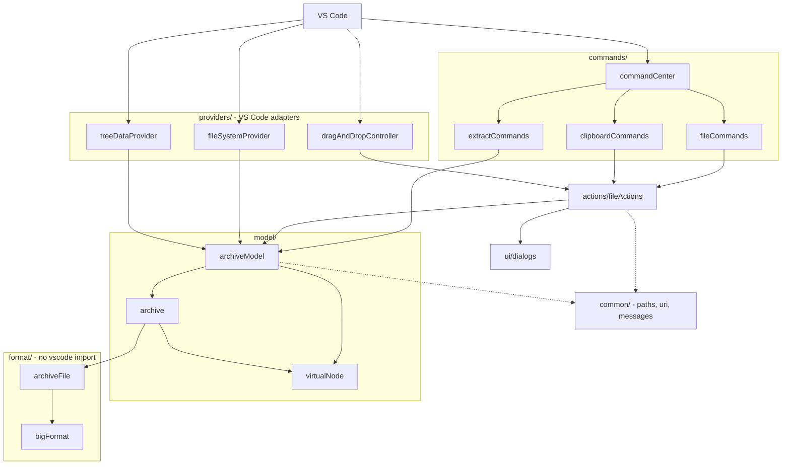

The layering is sound: `format` knows nothing about VS Code, `model` knows
nothing about commands, and the adapters are thin. Two problems remain, and
both are about **who owns a rule**, not about classes.

---

## 2. Problem one: three names for the same thing

The same entry is addressed three different ways, and two of them are plain
`string`, so nothing stops you mixing them up.

| name | example | spoken by |
| --- | --- | --- |
| URI | `bigfs:/mods/textures.big/data/a.ini` | VS Code |
| node path | `/mods/textures.big/data/a.ini` | tree, commands, actions |
| entry path | `data/a.ini` | archive, format layer |

### The round trip

There are **16 places** that turn a node into a URI. Most hand it straight to
the model, which turns it back into the node the caller already had:

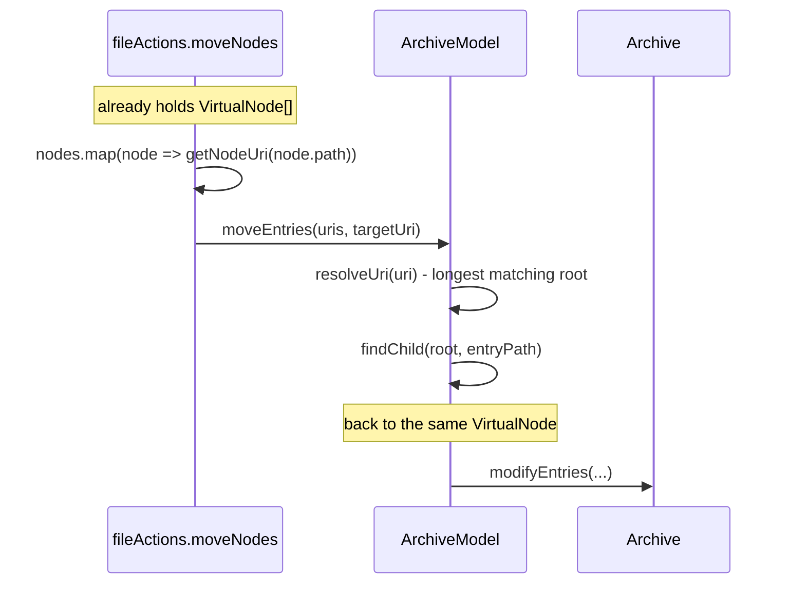

Concretely, in `actions/fileActions.ts`:

```ts
const acceptedUris = acceptedNodes.map((node) => getNodeUri(node.path));

await archiveModel.moveEntries(acceptedUris, getNodeUri(targetDirectory.path));
```

Nobody in that path had a URI to begin with. `moveNodes` is called from the
clipboard command and from the drop controller, both of which hold nodes.

### Why it matters

A URI is VS Code's currency. It should enter at the adapter boundary, be
resolved once, and never be reconstructed again. Today the model's public API
demands URIs, so every caller has to know how to build one, which means every
caller has to know the node path shape, which means the path shape is a rule
maintained in seven files instead of one.

### Proposed

**a. Brand the two path types** so the compiler separates them:

```ts
// common/paths.ts
declare const pathBrand: unique symbol;

export type NodePath = string & { readonly [pathBrand]: 'node' };
export type EntryPath = string & { readonly [pathBrand]: 'entry' };
```

`getParentPath` and friends become generic over the brand, so they still work
for both but never let one become the other by accident.

**b. Make the core speak nodes, not URIs.** URIs are translated in exactly one
place:

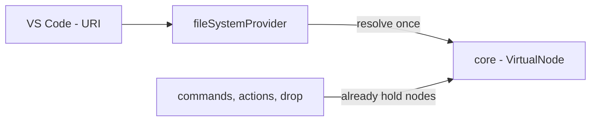

The signature change is small:

```ts
// before
moveEntries(sourceUris: Uri[], targetDirectoryUri: Uri): Promise<void>

// after
moveEntries(sources: readonly VirtualNode[], target: VirtualNode): Promise<void>
```

`fileSystemProvider` keeps a `resolve(uri): VirtualNode | undefined` and is the
only caller that needs it.

---

## 3. Problem two: one operation shape, written six times

Every mutation runs the same sequence, and each one is hand-written with a
different subset remembered:

| operation | validate | entry change | empty directory work |
| --- | --- | --- | --- |
| `writeFile` | writable path | put one | none |
| `createDirectory` | writable path | none | keep one |
| `deleteEntries` | not the root | remove many | keep emptied, forget below target |
| `applyMoves` | not into itself | move many | keep emptied, relocate tracked |
| `copyEntries` | not into itself | copy many | none |
| `addFiles` | writable path per file | put many | none |

Then all six end with rebuild the tree and fire the event.

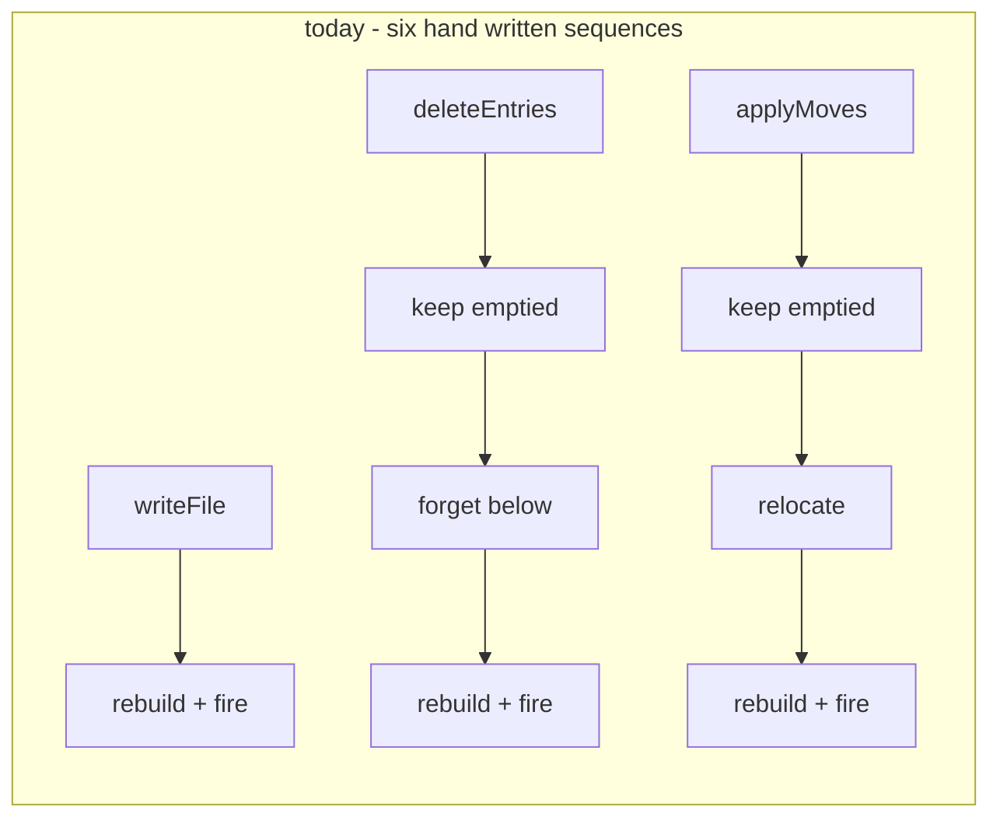

Nothing enforces the order and nothing enforces that a new operation does the
bookkeeping at all. That is the "multiple places have to take care of
consistency" feeling, and it is the single biggest source of it.

### The key observation

**The directory bookkeeping is derivable from the changes.** It does not need to
be specified per operation:

- removing an entry means its ancestors may have just become empty, so they must
  be kept if the tree should still show them
- moving an entry means tracked empty directories underneath it move with it
- adding an entry means any tracked empty directory it fills is no longer empty

Which means an operation only has to say **what changes**, and one runner can do
the rest, always in the same order.

### Proposed

```ts
// model/plan.ts
export type EntryChange =
  | { kind: 'put'; path: EntryPath; source: EntrySource }
  | { kind: 'remove'; path: EntryPath }
  | { kind: 'move'; from: EntryPath; to: EntryPath }
  | { kind: 'copy'; from: EntryPath; to: EntryPath }
  | { kind: 'keepDirectory'; path: EntryPath };

export type EntrySource =
  | { kind: 'data'; content: Uint8Array }
  | { kind: 'file'; path: string };

export interface ArchivePlan {
  archive: Archive;
  changes: readonly EntryChange[];
}
```

One runner owns the sequence:

```ts
const apply = async (plan: ArchivePlan): Promise<void> => {
  validate(plan);                                   // throws FileSystemError
  await plan.archive.modifyEntries((entries) =>
    plan.changes.forEach((change) => applyChange(entries, change)),
  );
  updateDirectories(plan.archive, plan.changes);    // derived, not passed in
  plan.archive.rebuildTree();
  fireChanged(plan.archive);
};
```

And each operation becomes a pure function that returns a plan:

```ts
const planDelete = (archive: Archive, nodes: readonly VirtualNode[]): ArchivePlan => ({
  archive,
  changes: nodes
    .flatMap((node) => archive.getFileEntryPaths(node))
    .map((path) => ({ kind: 'remove', path })),
});
```

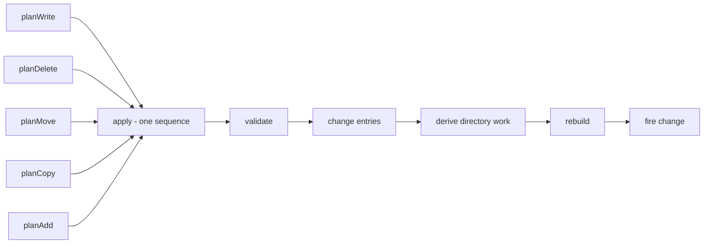

The payoff: adding an operation means writing one pure function that returns
changes. It cannot forget step four, because step four is not its job. The plans
are also trivially testable without an extension host, since they are data.

---

## 4. Target shape: a core with API layers

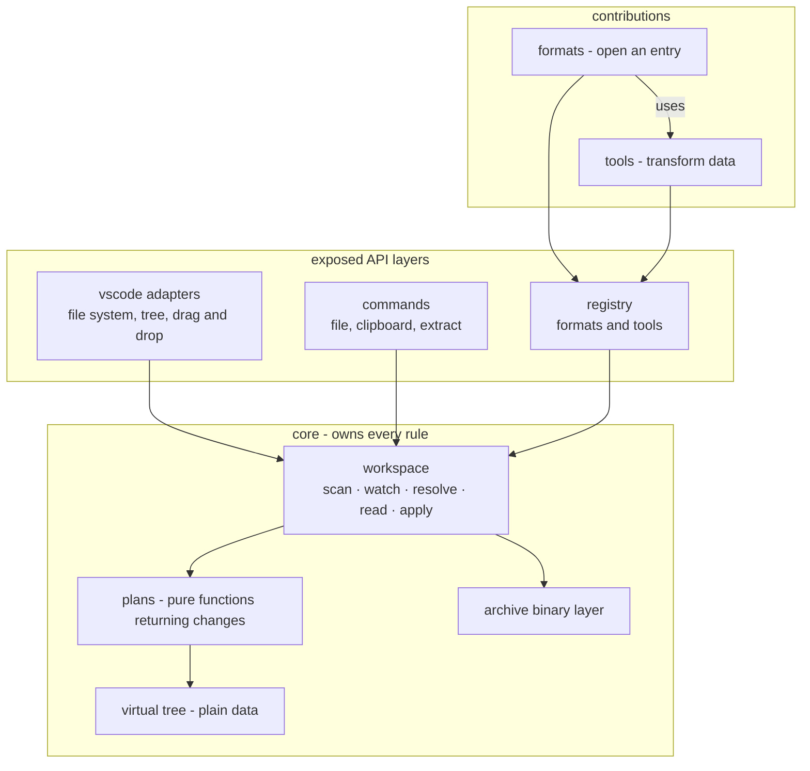

The core owns every rule that is currently spread out: casing, path shape, URI
resolution, operation order, queueing, batching, change notification. Everything
above it works with nodes and bytes.

> **Naming collision to settle first.** `src/format/` currently means "the BIG
> archive binary format", which clashes with formats as a plug-in concept. The
> binary layer should move to `core/archive/` so `formats/` is free for the
> thing you actually call a format.

### Proposed layout

```
src/
  core/
    archive/       bigFormat, archiveFile      (today: format/)
    workspace/     scan, watch, resolve, apply (today: model/archiveModel)
    tree/          virtualNode                 (today: model/virtualNode)
    plans/         one plan per operation, pure
  tools/           pure transforms - no vscode, no archive
    dds/decodeDds
    apt/parseApt, apt/writeApt
    image/encodePng
  formats/         entry to rendered thing - archive and editor bound
    dds
    apt
  providers/       vscode adapters, unchanged in spirit
  commands/        unchanged in spirit
  actions/         orchestration shared by commands and drop
  ui/              dialogs
  common/          paths, uri, messages
```

The dependency rule is one directional and easy to check: `tools` import
nothing from `core`, `formats` may import both, `providers` and `commands`
import `core` and the registries but never a tool directly.

---

## 5. Tools and formats

Two different kinds of contribution, and they compose.

| | **tool** | **format** |
| --- | --- | --- |
| answers | "transform this data" | "open this entry" |
| input | bytes or a parsed structure | an entry in an archive |
| knows about archives | **no** | yes |
| knows about VS Code | **no** | yes, it renders |
| example | decode DDS to pixels, encode PNG | show a `.dds` in an editor |
| testable in the unit lane | yes, no host needed | no, needs the host |

The rule that keeps them apart: **a tool never touches an archive, a URI, or the
editor.** It is data in, data out. That makes tools reusable, unit testable
without an extension host, and usable by each other. A format is the thin
binding that gets bytes out of an archive, runs tools over them, and renders the
result.

### Why `.apt` is a mix, and how that resolves

An `.apt` is both: something you open, and something you convert. Split along
the rule above and it stops being ambiguous:

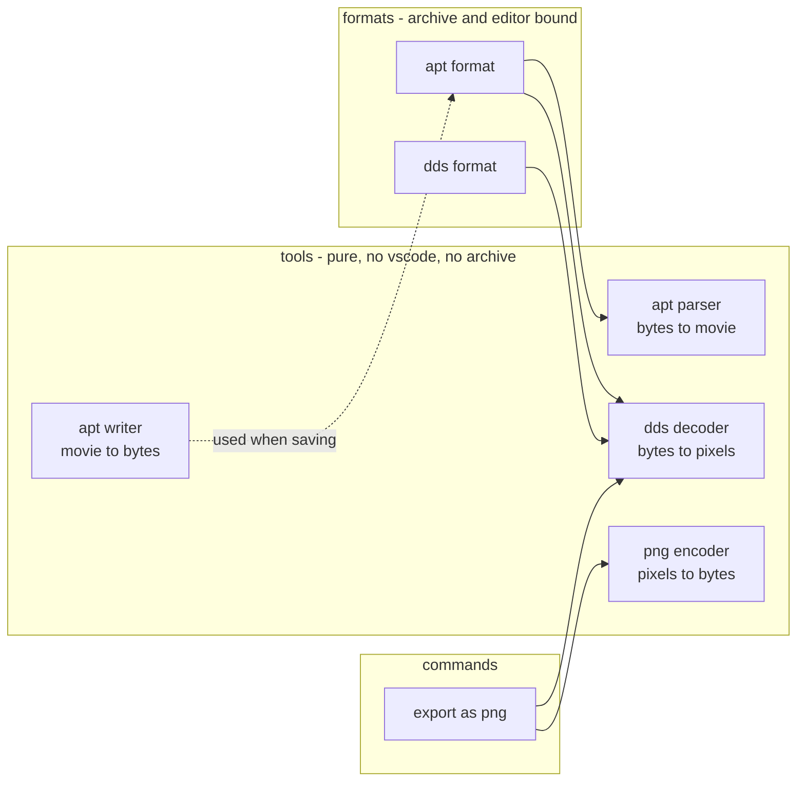

The `.apt` parser is a tool: give it the three buffers, get a structure back. It
can be tested against fixtures with no editor running. The `.apt` **format** is
what knows that `unit.apt` needs `unit.const` and `unit.dat`, fetches them, calls
the parser tool, and hands the result to a renderer. When the movie references
textures, the format fetches those and runs the **dds decoder tool** over them —
one tool used by two formats and by a command.

### The awkward requirement

An `.apt` is useless alone. It needs its `.const` and `.dat` siblings, and it
references textures whose names are **only known after parsing**. So a format
cannot declare its dependencies up front as a static list. It needs to ask for
more entries while it works.

That rules out the obvious design of "declare related files, receive buffers"
and points at handing the format a **reader** instead.

### Proposed shape

A tool is a named function with typed input and output. Nothing else:

```ts
// tools/registry.ts
export interface Tool<Input, Output> {
  readonly id: string;
  run(input: Input, tools: ToolBox): Promise<Output> | Output;
}

/** Lets a tool reach another tool by id, resolved lazily so order of
 *  registration does not matter and two tools may reference each other */
export interface ToolBox {
  use<I, O>(tool: Tool<I, O>): (input: I) => Promise<O>;
}
```

A format binds an entry to tools and to a renderer:

```ts
// formats/registry.ts
export interface FormatContext {
  /** The entry the format was invoked on */
  readonly entry: EntryRef;

  /** Same base name, different extension - x.apt finds x.const */
  sibling(extension: string): EntryRef | undefined;

  /** Entries in a directory, for formats that scan */
  list(directory: EntryPath): readonly EntryRef[];

  /** Bytes of an entry, batched behind one open archive handle */
  read(entry: EntryRef): Promise<Uint8Array>;
  readAll(entries: readonly EntryRef[]): Promise<Map<EntryPath, Uint8Array>>;

  /** The same tools a command or another format would use */
  readonly tools: ToolBox;
}

export interface ArchiveFormat<T> {
  readonly id: string;
  matches(entry: EntryRef): boolean;
  parse(context: FormatContext): Promise<T>;
  /** Optional, only for formats that can write back */
  serialize?(value: T, context: FormatContext): Promise<EntryChange[]>;
}
```

A format never sees a URI, never folds a case, never opens a file, and never
learns which archive it is in. A tool additionally never sees an entry.

Note `serialize` returns **changes**, not bytes written to disk. An editor
saving an `.apt` produces a plan that goes through the same runner as every
other mutation, which means it inherits the queueing, the bookkeeping and the
tree refresh for free.

### Opening an .apt

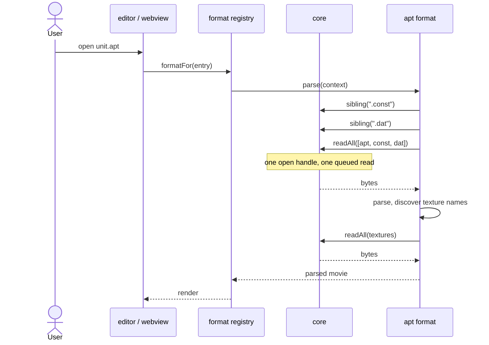

The batching that step 12 built is exactly what makes the second `readAll`
cheap, and the format author never has to know it exists.

### A simpler one, .dds

The tool, which knows nothing about archives and is unit testable today:

```ts
// tools/dds/decodeDds.ts
export const decodeDds: Tool<Uint8Array, DecodedTexture> = {
  id: 'dds.decode',
  run: (bytes) => decode(bytes),
};
```

The format, which is the binding and nothing more:

```ts
// formats/dds.ts
export const ddsFormat: ArchiveFormat<DecodedTexture> = {
  id: 'dds',
  matches: (entry) => entry.name.toLowerCase().endsWith('.dds'),
  parse: async (context) =>
    context.tools.use(decodeDds)(await context.read(context.entry)),
};
```

### Adding a new format or tool later

This is the ergonomic target. Adding either should touch **one new file and one
registration line**, and nothing else:

```ts
// extension.ts
registerTools(decodeDds, encodePng, parseApt, writeApt);
registerFormats(ddsFormat, aptFormat, geometryFormat);
```

| you want to | you write | you touch |
| --- | --- | --- |
| decode a new texture kind | a tool | `tools/`, one registration |
| open a new file kind | a format | `formats/`, one registration |
| convert A to B from the menu | a tool plus a command | `tools/`, `commands/` |
| open a kind that needs siblings | a format using `sibling` | `formats/` only |

### What the registry gives the rest of the extension

- a custom editor asks "is there a format for this entry" and renders it
- the tree can show a format specific icon or description
- a command like "export as PNG" composes two tools without either knowing
  about the archive
- a format that implements `serialize` becomes editable, through the same plan
  runner as everything else

---

## 6. What is deliberately not changing

- **`BigTreeItem extends TreeItem` stays.** It is the one place inheritance
  actually buys something and you are happy with it.
- **Row ordering matches the explorer**, directories first and then files, each
  by name. Already implemented in `providers/treeDataProvider`.
- **`VirtualNode` stays plain data** operated on by free functions. It is the
  one type with tens of thousands of instances per archive, so no methods, no
  prototypes, no closures per node.
- **Errors stay exceptions** at the VS Code boundary, because the provider API
  requires thrown `FileSystemError`s. Tagged errors like `NotAnArchiveError`
  cover the few cases callers branch on.
- **The `format/` layer stays as is.** It is already pure, testable and
  vscode-free.

---

## 7. What the roadmap changes

Five planned features, checked against the design above. Two fit as they are,
three break an assumption, and one of those changes what should be done first.

| feature | fits the design | what it breaks |
| --- | --- | --- |
| manually added archives, grouped by their folder | no | identity is workspace relative |
| archives shown in the folders they live in | no | the tree top level is flat, and rows are always archive content |
| merged game file system with overrides | no | one archive owns one entry |
| cross archive move and copy | no | a plan targets one archive |
| INI and INC language support | yes, as a new API layer | needs a derived data cache |
| in game previewers for parts of a file | yes, as formats | needs sub entry granularity |

### Why the folder structure waits for sources

Showing `mods/textures.big` nested under a `mods` row rather than flat looks
like a view change, and it is not, for two reasons.

**A folder row is a node kind that does not exist.** Every row today is a
`VirtualNode`, which requires an `archivePath` because it describes something
*inside* an archive. A folder on disk has no archive. It also breaks
`BigTreeItem`, which sets `resourceUri` to a `bigfs:` URI: for a folder row that
URI resolves to nothing, so VS Code would ask the file system provider to stat
it and get a not found back, losing the icon. Such a row wants either the real
`file:` URI or none at all, plus its own `contextValue` so the context menu and
drop handling can refuse it.

**The top level is exactly what sources restructures.** Once archives can come
from several places the tree becomes source, then folders, then archives.
Building the folder grouping against workspace only identity means building it
twice.

So it belongs *with* step 1, not before it: one pass that introduces sources,
folder rows and the new URI shape together.

### The one thing to settle before anything else: identity

Today an archive is identified by its **workspace relative path**, and an entry
by its position inside one archive. Three roadmap features contradict that:

- an archive in `D:\test` has no workspace relative path
- in the merged view an entry is identified by its **game path**, and several
  archives may hold that same path
- during a cross archive move the same content exists in two archives at once

So the URI shape has to grow a **view** and a **source** before the rest is
built on it. Doing this during step 1 costs nothing extra; doing it later means
rewriting every path rule twice.

```
bigfs:/archives/<source>/<archive path>/<entry path>    the tree you have today
bigfs:/game/<source>/<entry path>                       the merged view
```

### Sources: the layer below archives

The core stops being workspace scoped. A **source** is a place archives come
from: the workspace, or a folder you added by hand. Archives group under it,
and adding another archive from the same folder joins the same node.

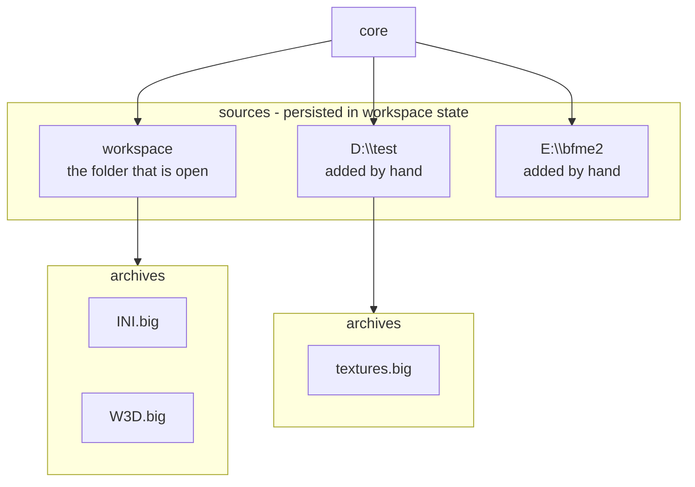

Consequences worth knowing now:

- `workspace.findFiles` and `asRelativePath` only work inside the workspace, so
  discovery becomes per source, with `RelativePattern` watchers for the folders
  you add by hand
- sources need to survive a reload, so they go in workspace state
- a source needs a **load order**, because the merged view depends on it

### The merged view is a second projection, not a second tree

The important part: merging and override resolution are **core rules**, not view
code. The core builds an index once and both trees read from it.

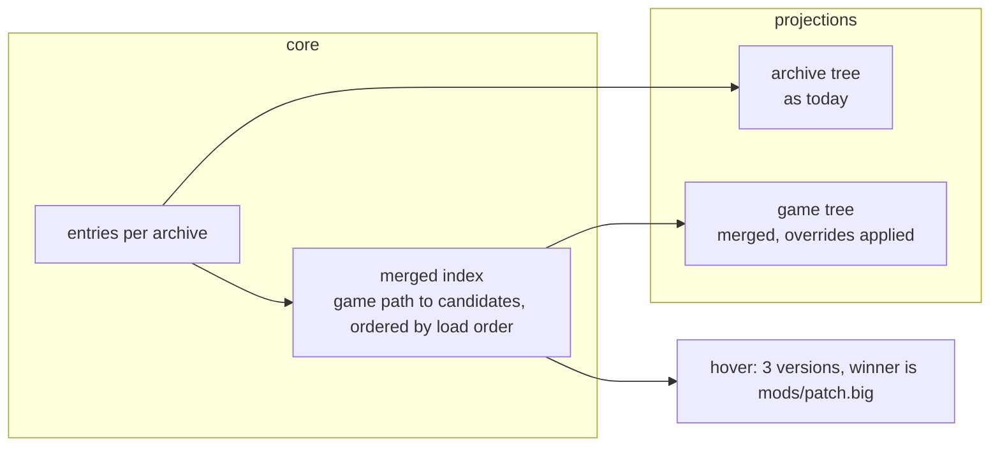

The index entry is the shape that answers your hover question directly:

```ts
export interface MergedEntry {
  path: EntryPath;                     // the path the game sees
  candidates: readonly EntryRef[];     // every archive that holds it, in load order
  winner: EntryRef;                    // the one the game actually reads
}
```

This is also what INI cross referencing needs: a symbol lookup has to resolve
against the **merged** file system, not one archive, or a reference from a mod
file into a base game file will not resolve.

### Cross archive operations change the plan type

Section 3 proposes a plan with a single `archive` field. If cross archive moves
are coming, make the plan a **transaction over several archives from the start**,
otherwise every operation gets rewritten later:

```ts
export interface ArchivePlan {
  steps: readonly ArchiveStep[];       // ordered, one archive each
}

export interface ArchiveStep {
  archive: Archive;
  changes: readonly EntryChange[];
}
```

Ordering matters and belongs in the runner, not in each operation: a cross
archive move **writes the target first and only then removes the source**, so a
failure halfway leaves a duplicate rather than a hole. Two archives cannot be
rewritten atomically, so the runner should make the safe order structural.

A new change kind carries content between archives without going through
memory:

```ts
| { kind: 'copyFrom'; source: EntryRef; to: EntryPath }
```

which reuses the streaming path that already exists for importing from disk.

### Language support and previewers need one thing added

Both need parsed results to be **cached and invalidated**, or every keystroke
reparses an INI that may live in another archive. The core already knows when an
archive changed, so it is the right owner:

```ts
derive<T>(entry: EntryRef, tool: Tool<Uint8Array, T>): Promise<T>
```

keyed by entry identity plus archive version, dropped when the archive changes.
With that, INI language features and previewers are both just consumers:

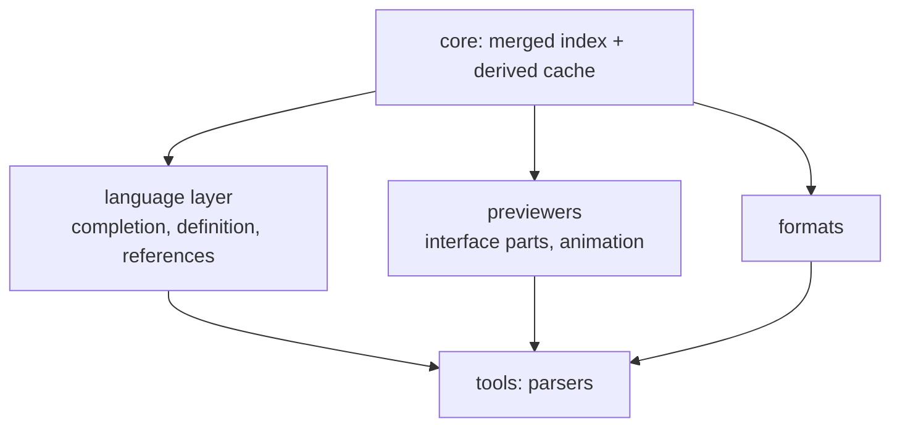

Previewers do add one requirement to the format API: they preview **part** of a
file, so a format needs an optional entry point that takes a location or symbol,
not just the whole entry.

---

## 8. Suggested order

Revised for the roadmap. The first two items swapped places compared to the
earlier draft, because identity has to be right before anything is built on it.

| # | change | why there | risk |
| --- | --- | --- | --- |
| 1 | Sources, folder rows and the view/source URI shape | four roadmap features contradict workspace relative identity, and the tree top level is rebuilt once | medium, changes every path rule once instead of twice |
| 2 | Core speaks nodes, brand the path types | removes 16 round trips, and lands with the new shape | low, mechanical, tests cover it |
| 3 | Plans and one runner, **multi archive from the start** | removes ordering rules from six places, and makes cross archive possible | medium, touches every operation |
| 4 | Move the binary layer to `core/archive/`, free the name `formats` | must happen before anything is called a format | low, a move |
| 5 | Tool registry plus the DDS decoder as the first tool | pure, unit testable, no host, no archive | low, additive |
| 6 | Format registry plus the DDS format | proves the binding with the simplest case | low, additive |
| 7 | Merged index and the game tree | needs 1 and 3, unlocks language support later | medium, new domain rule: load order |
| 8 | Cross archive move and copy | falls out of 3 plus `copyFrom` | low once 3 is done |
| 9 | `.apt` parser and writer as tools | you are writing these anyway, and they need no editor | medium, your parser |
| 10 | `.apt` format, the grouped entry case | exercises `sibling`, the second read, and `serialize` | medium |
| 11 | Derived cache, then INI and INC language support | needs 7 for cross archive references | large, own project |

Steps 1 to 4 are refactors with the existing tests as the safety net. Steps 5
onwards are new surface area and do not touch what exists.

**Manually added archives can land any time after step 1.** They are a source
implementation plus a command, not a change to the core.

**If you want to start on the parser sooner:** step 6 does not actually depend
on 1 to 5. A tool is a pure function over buffers, so the `.apt` parser can be
written and unit tested against fixtures right now, and wired into a format
later. That is the main practical argument for the tool and format split.
